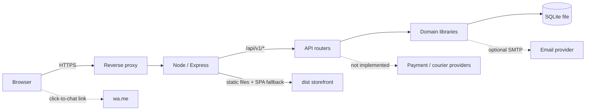
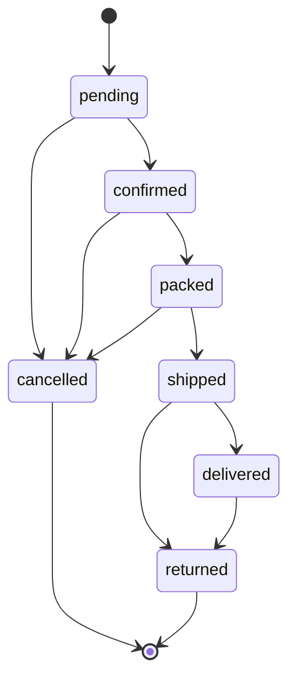

# Architecture

## Overview

Sree Collections is a single-repository web application with two build outputs:

1. A static React storefront (`dist/`) served by the API in production.
2. An Express API (`dist-server/`) backed by a local SQLite file.

There is no separate worker, cache, message queue or third-party service requirement. The architecture favours a small deployment surface: one Node process, one database file, one HTTPS reverse proxy.



## Runtime composition

`server/index.ts`:

- Loads and validates environment configuration (`server/config.ts`, Zod).
- Opens SQLite, sets foreign keys, a 5 s busy timeout and WAL mode.
- In development only, seeds the demo catalogue when the database has no categories.
- Starts Express on `PORT`, then periodically removes expired sessions and abandoned guest carts (every 6 hours).
- Handles `SIGINT`/`SIGTERM` with a graceful close and a 10 s forced-exit guard.

`server/app.ts` builds the request pipeline:

```
Helmet → compression → body parsers → cookie parser
→ request logging (not in test) → origin check on mutating /api requests
→ API rate limit (900 / 5 min) → Cache-Control: no-store for /api
→ CSRF double-submit check → routers → /api 404 → static + SPA fallback → error handler
```

Production-only additions: a strict Content-Security-Policy, `trust proxy = 1`, and static serving of `dist/` with assets cached for one hour and `index.html` set to `no-cache`.

Development uses Vite on port 5175 and proxies `/api` to port 4000, so cookies are same-origin in both modes.

## Frontend

### Routing

`src/App.tsx` lazy-loads every page. Public routes live under `StoreLayout`; `/account/*` is wrapped by `RequireAuth`; `/admin/*` is wrapped by `RequireStaff` and an additional per-section role gate. Unknown paths render the not-found page.

Public routes: `/`, `/shop`, `/gift-finder`, `/product/:slug`, `/cart`, `/checkout`, `/order/:orderNumber`, `/track`, `/faq`, `/contact`, `/offers`, `/journal`, `/about`, `/stores`, `/policies/:slug`, `/login`, `/register`, `/forgot-password`.

Account routes: dashboard, orders, order detail, wishlist, addresses, reviews, returns, profile.

Admin routes: dashboard, products, product editor, categories, stock, orders, order detail, returns, customers, coupons, reviews, tickets, zones, settings, audit.

### State

- **TanStack Query** owns server state (catalogue, cart, orders, admin lists). API responses are marked no-store; the client refetches on navigation where correctness matters.
- **AuthContext** reads `/auth/session`, exposes login/register/logout and the current role.
- **CartContext** wraps the cart query, mutations, drawer state and optimistic UI. The cart cookie is HttpOnly; the client never stores cart contents as authority.
- **SiteContext** loads `/content/site` and `/content/home` for store settings, policies, delivery zones and capability labels.
- **ToastContext** provides short non-blocking feedback.

### Styling and performance

CSS is split into ordered layers imported by `src/styles.css`: tokens, base, components, storefront, commerce, account, admin, responsive. There is no CSS-in-JS runtime and no remote font request; fonts are self-hosted through `@fontsource`.

Performance decisions aimed at low-end phones:

- No `backdrop-filter`, parallax or heavy animation libraries. Transitions are limited to colour, transform and opacity.
- Product artwork is SVG, so there are no large raster images to decode on the storefront.
- All routes are code-split; the admin dashboard (Recharts) is only downloaded by staff who open it.
- Mobile product pages use a compact buy bar and stacked layouts rather than hiding content.
- Wide admin tables scroll inside `.table-wrap`, which uses `contain: paint` to stop scroll overflow leaking to the document and to reduce paint work.
- `content-visibility` is not relied upon for critical above-the-fold content; the layout remains readable without JavaScript-driven measurement.
- `prefers-reduced-motion` disables non-essential transitions.

Responsive breakpoints sit at 1200, 1080, 960, 900, 860, 760, 640, 520 and 400 px, with `hover: none` adaptations for touch.

## Backend modules

| Module | Responsibility |
| --- | --- |
| `routes/auth.ts` | Register, sign in/out, session, password change, honest forgot-password response |
| `routes/catalog.ts` | Categories, facets, product list/detail, reviews, gift finder, suggestions, delivery check |
| `routes/cart.ts` | Guest/user carts, item add/update/remove, coupon, shipping estimate, clear |
| `routes/checkout.ts` | Quote-based order placement, idempotency, tracking lookup, invoice, order view |
| `routes/account.ts` | Profile, addresses, orders, cancellation, wishlist, reviews, returns |
| `routes/admin.ts` | Staff summary, catalogue CRUD, stock, orders, coupons, zones, settings, moderation, audit |
| `routes/content.ts` | Store settings, home content, support tickets, newsletter consent |
| `lib/pricing.ts` | Authoritative quote: line prices, discounts, coupons, gift wrap, shipping, GST, COD |
| `lib/shipping.ts` | PIN validation, zone matching, fee and ETA |
| `lib/orders.ts` | Status state machine, serialization, restock and stock-movement rules |
| `lib/auth.ts` | Password hashing, opaque sessions, CSRF, role guards |
| `lib/catalog.ts` | Published-product serialization and filtering |
| `lib/invoice.ts` | Escaped, printable HTML invoice |
| `lib/invoice-pdf.ts` | A4 PDF invoice rendered with PDFKit for download and email attachment |
| `lib/notifications.ts` | Order email outbox, customer/owner templates, SMTP send and resend |
| `lib/mailer.ts` | SMTP transport from `SMTP_URL`; honest `not_configured`/`failed` results |
| `lib/audit.ts` | Append-only staff audit entries |

## Authoritative pricing and checkout

The browser sends a cart action, never a price. On checkout:

1. Validate the payload with Zod (contact, addresses, PIN, payment method, terms, optional idempotency key).
2. Return an existing order if the idempotency key already produced one for the same customer.
3. Resolve the cart from its HttpOnly cookie or the signed-in user.
4. Rebuild the quote from the database: published product and variant price, sale price, stock, gift-wrap eligibility and fee, coupon rules, shipping zone, tax mode and COD limits.
5. Reject unpurchasable lines (unpublished, variant required/inactive, insufficient stock, invalid coupon, unserviceable PIN).
6. Reject online payment with `503 PAYMENT_PROVIDER_UNAVAILABLE`.
7. Inside a single SQLite `BEGIN IMMEDIATE` transaction: create the order and item snapshots (including the matched delivery zone and ETA), decrement stock (product or variant), write stock movements, write the initial order event, record coupon redemption, clear the cart.
8. After commit, queue order-email outbox rows. When SMTP is configured they are sent in the background with the invoice PDF attached; otherwise they are recorded as `not_configured`.
9. Return the order, the outbox channel statuses and a `cod_pending` payment state. The confirmation page then offers invoice links and the WhatsApp handoff.

Money is stored and calculated exclusively in integer paise. Display formatting happens in the client with `Intl.NumberFormat("en-IN")`.

## Order lifecycle



- Transitions are validated by `canTransition`; invalid moves return `409 INVALID_TRANSITION`.
- Cancelling or returning restocks product/variant quantities and writes stock movements with the actor and reference.
- A COD order becomes `paid` only when staff mark it delivered; cancellation restores the order state but does not invent a refund transaction.
- Customers may cancel only while the order is `pending` or `confirmed`; returns are requested from the account area and reviewed by staff.
- Each status change appends an `order_events` row. Staff notes are separate events. Tracking number and link are optional and must come from a real courier.

## Security boundaries

- Every mutating request under `/api` passes a double-submit CSRF check (`sc_csrf` cookie equals `x-csrf-token`) and, when an `Origin` header is present, an exact `APP_ORIGIN` check.
- Sessions are opaque 32-byte tokens; only SHA-256 hashes are stored. Passwords use bcrypt cost 12.
- Admin routers call `requireAuth` and then a role guard per route. Frontend gates are convenience only; the API is the authority.
- Login, registration, checkout and lookup endpoints have dedicated rate limits.
- Order tracking requires the order number plus the matching email unless the viewer is signed in as the owner of that order. HTML and PDF invoices use the same rule.
- The invoice renderer HTML-escapes all customer-supplied fields; the PDF renderer uses PDFKit text primitives rather than raw HTML.
- Order emails are sent only from the server; SMTP credentials never reach the browser.

See [Security](SECURITY.md) for the full control list and deployment checklist.

## Failure behaviour

- Validation failures return `400 VALIDATION_ERROR` with field-level details.
- API errors use one envelope: `{ "error": { "code", "message", "details" } }`.
- Unexpected errors return a generic `500 INTERNAL_ERROR`; stack traces are not sent to clients.
- Health reports database status and capability labels. A provider label of `configured_unverified` only means environment variables are present; it does not mean the provider is integrated or tested.
- Nothing is silently substituted: disabled online payment and courier features fail loudly, and email/WhatsApp states are reported exactly as `not_configured`, `queued`, `sent`, `failed` or `click_to_chat`.
