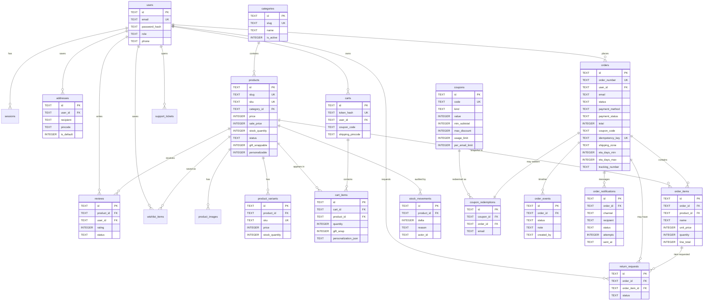

# Database

SQLite, accessed through Node's built-in `node:sqlite` (`DatabaseSync`). The default development file is `data/sree.db`; the path is controlled by `DATABASE_PATH`.

## Operational settings

- `PRAGMA foreign_keys = ON` on every connection.
- `PRAGMA journal_mode = WAL` for on-disk databases (not for `:memory:`).
- `PRAGMA busy_timeout = 5000` so concurrent writes wait rather than failing immediately.
- Migrations are versioned rows in `schema_migrations`; each migration runs inside `BEGIN IMMEDIATE` and rolls back on failure.
- Writes that must be atomic use the `transaction()` helper (`BEGIN IMMEDIATE` → commit/rollback).

There is no ORM. SQL is parameterised throughout; dynamic column lists are built only from fixed allow-lists in the admin routes.

## Conventions

| Rule | Detail |
| --- | --- |
| Money | Integer **paise** (`149900` = ₹1,499.00). Never floating point, never a rupee string |
| Timestamps | UTC ISO-8601 text, e.g. `2026-10-24T07:59:00.000Z` |
| IDs | UUID strings from `crypto.randomUUID()` except seeded categories/products which use readable IDs |
| Booleans | SQLite integers `0`/`1`, converted at the serialization boundary |
| Status values | Constrained by `CHECK` where the domain is fixed |
| Deletion | Products use `archived`; orders and financial records are never hard-deleted |
| Email | `COLLATE NOCASE` on user, order and subscriber emails |

## Entity-relationship diagram

Core commerce entities and their foreign keys:

## Table reference

| Table | Purpose | Notable rules |
| --- | --- | --- |
| `users` | Customers and staff | Unique case-insensitive email; role `CHECK`; bcrypt hash only |
| `sessions` | Signed-in sessions | Unique SHA-256 token hash; expiry; cascades with user |
| `addresses` | Saved delivery addresses | Per-user default flag managed by the API |
| `categories` | Catalogue groupings | Unique slug; sort order; active flag |
| `products` | Catalogue and inventory | Unique slug and SKU; paise prices; status `draft/scheduled/published/unpublished/archived/discontinued`; gift-wrap and personalisation flags; SEO fields; dimensions and preparation days |
| `product_images` | Ordered image URLs | Alt text required; SVGs are used by the seed |
| `product_variants` | Size/colour options | Unique SKU; optional price override; own stock |
| `carts` | Guest and user carts | Token stored only as a hash; optional coupon and PIN |
| `cart_items` | Cart lines | Quantity 1–20; unique by cart/product/variant; gift message and personalisation JSON |
| `coupons` | Discount definitions | Percent/fixed/free-shipping; minimum, cap, dates, total and per-email limits, first-order flag |
| `coupon_redemptions` | One redemption per order | Unique `order_id`; email recorded for limits |
| `orders` | Order header and snapshots | Unique order number; integer totals; JSON address snapshots; unique idempotency key; tracking fields; delivery zone name and ETA snapshot |
| `order_items` | Immutable line snapshots | Name/SKU/price copied at purchase time; personalisation and gift-wrap flags |
| `order_events` | Status and note timeline | Appended on every staff transition and note |
| `order_notifications` | Order email outbox | One row per attempted recipient (`email_customer`/`email_owner`); status `queued/sent/failed/not_configured`; recipient, provider, error, attempts and sent time. Indexed by order and status |
| `stock_movements` | Inventory audit trail | Delta, reason, reference, actor, timestamp; written on checkout, cancel, return and manual adjustment |
| `reviews` | Product reviews | One per user per product; `pending/approved/rejected`; verified-purchase flag |
| `wishlist_items` | Saved products | Composite primary key |
| `support_tickets` | Contact messages | Human-readable ticket number; open/in-progress/closed |
| `shipping_zones` | PIN coverage and fees | Comma/range PIN tokens; fee in paise; free-above threshold; ETA range. Seed includes an all-India fallback plus a Kurnool local zone |
| `settings` | JSON store configuration | Store (including contact email/phone/WhatsApp), notifications, tax, gift wrap, COD, returns, operational and home content |
| `audit_logs` | Staff action log | Actor, action, entity, JSON details; append-only |
| `return_requests` | Return workflow | Requested → approved/rejected → received → refunded/closed |
| `newsletter_subscribers` | Consent record | Timestamped consent and unsubscribe |
| `search_events` | Anonymous search terms and result counts | Used for catalogue insight, no personal data |

## Pricing-related data

Products carry `price`, optional `sale_price`, optional `mrp`, `cost_price`, `tax_rate_bps`, `hsn_code` and `stock_quantity`. Variants may override price and stock. The server quote ignores any price sent by the browser and recomputes:

- Effective unit price = active variant price, else sale price, else price.
- Gift wrap = configured per-unit fee, only for wrappable products.
- Coupon = percentage with cap, fixed with sub-total floor, or free shipping; validated against dates, usage, email and first-order rules.
- Shipping = first matching active zone; fee waived above the zone threshold.
- Tax = inclusive by default (backed out of line totals) or exclusive; stored both ways for reporting.
- COD availability = globally enabled, order total within the configured maximum, payment method `cod`.
- Total = goods after discount + gift wrap + shipping + exclusive tax.

Orders store the resulting `subtotal`, `discount`, `gift_wrap_total`, `shipping_fee`, `tax_included`, `tax_exclusive`, `total` and `tax_mode` so history remains interpretable if settings change later. They also snapshot the matched delivery `shipping_zone` and ETA range, so a later zone edit does not rewrite past promises.

## Backup and migration notes

- The only state is the SQLite file (plus its `-wal` and `-shm` companions while running). Back up with a checkpoint or the online backup API; copying only the `.db` while WAL is active can lose recent commits.
- Never edit schema by hand in production; add a new numbered migration to `migrations` in `server/db.ts`.
- Product, order and audit history is intentionally append-oriented. Cancelling an order updates status and restocks; it does not delete the record.

See [Operations](OPERATIONS.md) for exact backup and restore commands.
